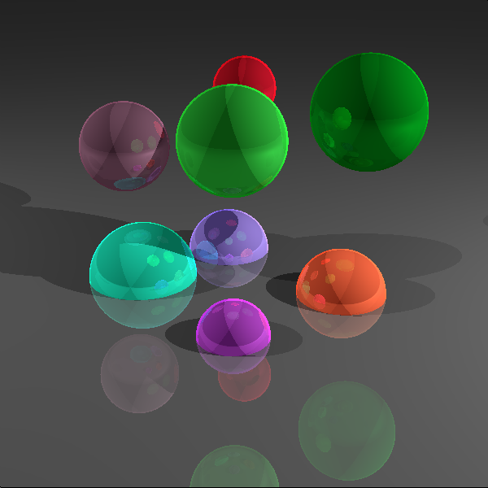
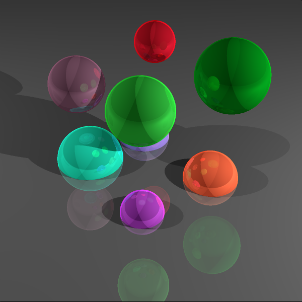

# Raytracer

A small CPU ray tracer written in C. The demo renders eight colored spheres on a reflective plane. It traces shadow rays from two point lights, follows reflections recursively, and displays the pixels in a FreeGLUT window.

## Build and run on Linux

Install a C compiler, CMake, FreeGLUT, OpenGL and GLU development libraries, and zlib. On Debian or Ubuntu, the packages include `build-essential`, `cmake`, `freeglut3-dev`, `libglu1-mesa-dev`, and `zlib1g-dev`.

```sh
git clone --recurse-submodules https://github.com/Coestaris/Raytracer.git
cd Raytracer
cmake -S . -B build -DCMAKE_BUILD_TYPE=Release \
  -DCMAKE_C_FLAGS=-DGL_GLEXT_PROTOTYPES -DGLUT_LIBRARY=glut
cmake --build build
./build/Raytracer
```

The `oil` submodule supplies the image and texture utilities. Edit `setupScene()` in `main.c` and rebuild to change the camera, lights, or sampling. `MSAAFactor = 2` traces a 2×2 grid of samples per pixel.

## Screenshots

| Default scene | Alternate camera with 2×2 sampling |
| --- | --- |
|  |  |
